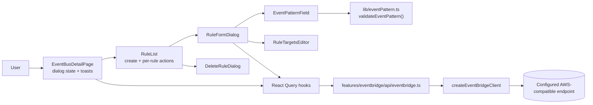
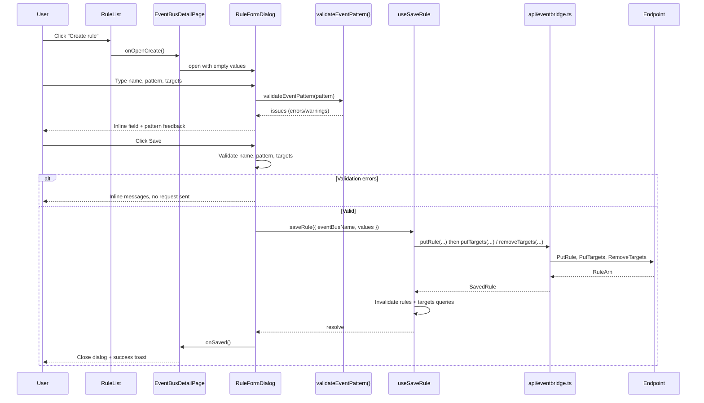
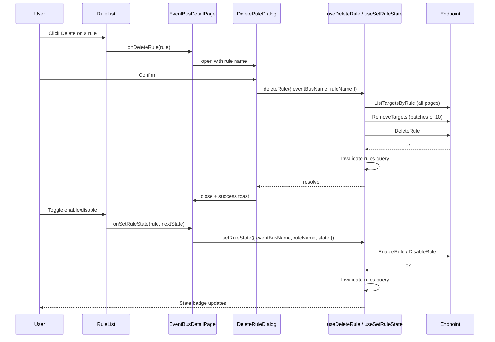

# Technical Specification: EventBridge Rule Management

## Architecture Overview

The feature extends the existing `eventbridge` feature module (see [feature 009](../009-eventbridge-eventbus-management/spec.md)) rather than introducing a new module. It follows the established layering used by SQS message sending (see [feature 011](../011-sqs-send-message/spec.md)): the page owns dialog state, feature components own presentation and form validation, React Query hooks own the request lifecycle, and the EventBridge API module calls the AWS SDK through the shared client factory.

Rule management is performed inline on the event bus detail view. The existing read-only `RuleList` becomes the hub: it gains a create action and per-rule edit, enable/disable, and delete actions. Create and edit share a single `RuleFormDialog` that hosts the event pattern field (with live validation) and the repeatable targets editor.

A dedicated, dependency-free pattern validator module (`src/features/eventbridge/lib/eventPattern.ts`) performs both JSON syntax parsing and EventBridge event-pattern semantic checks and returns a structured issue list. It is a pure function so it can be unit tested exhaustively and reused by scripts if needed.



### Create / update rule flow



### Delete and enable/disable flow



## Project Structure

```text
src/
├── features/eventbridge/
│   ├── api/
│   │   └── eventbridge.ts            # Add putRule, deleteRule, enable/disableRule, put/removeTargets
│   ├── lib/
│   │   └── eventPattern.ts           # NEW: validateEventPattern(), formatEventPattern()
│   ├── components/
│   │   ├── RuleList.tsx              # Add create action + per-rule actions
│   │   ├── RuleFormDialog.tsx        # NEW: create/edit form
│   │   ├── DeleteRuleDialog.tsx      # NEW: destructive confirmation
│   │   ├── EventPatternField.tsx     # NEW: textarea + validation feedback
│   │   ├── RuleTargetsEditor.tsx     # NEW: repeatable target rows
│   │   └── index.ts                  # Export new components
│   ├── hooks/
│   │   ├── useSaveRule.ts            # NEW: putRule + target reconciliation mutation
│   │   ├── useDeleteRule.ts          # NEW: deleteRule mutation
│   │   ├── useSetRuleState.ts        # NEW: enable/disable mutation
│   │   └── index.ts                  # Export new hooks
│   └── types/
│       └── eventbridge.ts            # Add rule-management + validation types
├── pages/
│   └── EventBusDetailPage.tsx        # Own rule dialog state + toast handling
tests/features/eventbridge/
├── lib/eventPattern.test.ts          # NEW: validator unit tests
├── api/eventbridge.test.ts           # Extend with rule mutation tests
├── hooks/eventbridge-hooks.test.tsx  # Extend with mutation tests
└── components/eventbridge-components.test.tsx  # Extend with dialog/editor tests
```

No new routes are added; rule management lives on the existing `/eventbridge/eventbuses/:name` route.

## Data Structures

Add to `src/features/eventbridge/types/eventbridge.ts`. Reuse the existing `RuleTarget` and `EventBridgeRule` types.

```typescript
type RuleState = 'ENABLED' | 'DISABLED';

// Editable target shape, aligned with the existing RuleTarget display type.
interface RuleTargetInput {
  id: string;
  arn: string;
  roleArn?: string;
  input?: string;
  inputPath?: string;
}

interface RuleFormValues {
  name: string;
  description?: string;
  eventPattern: string;
  state: RuleState;
  targets: RuleTargetInput[];
}

interface SaveRuleInput {
  eventBusName: string;
  /** Present when editing an existing rule; the rule name is immutable. */
  originalName?: string;
  /** Targets that existed before an edit and must be removed if omitted. */
  originalTargetIds?: string[];
  values: RuleFormValues;
}

interface DeleteRuleInput {
  eventBusName: string;
  ruleName: string;
}

interface SetRuleStateInput {
  eventBusName: string;
  ruleName: string;
  state: RuleState;
}

interface SavedRule {
  name: string;
  arn?: string;
}
```

### Pattern validation types (`lib/eventPattern.ts`)

```typescript
type EventPatternSeverity = 'error' | 'warning';

interface EventPatternIssue {
  /** JSON-path-like location, e.g. "detail.status" or "detail[...][0]". */
  path: string;
  message: string;
  severity: EventPatternSeverity;
}

interface EventPatternValidationResult {
  valid: boolean; // true when no error-severity issues exist
  issues: EventPatternIssue[];
  parsed?: unknown; // present only when JSON syntax is valid
  formatted?: string; // pretty-printed JSON when syntax is valid
}

const EVENT_PATTERN_MAX_LENGTH = 4096;
```

## Pattern Validator Specification

`validateEventPattern(value: string): EventPatternValidationResult` is pure and dependency-free.

### Step 1 — JSON syntax

- A blank or whitespace-only pattern is valid and omitted from the `PutRule` request, matching all events. It has no formatted preview.
- For non-empty input, trim before parsing.
- Enforce `EVENT_PATTERN_MAX_LENGTH` (4096) on the raw string; exceeding it produces an error and skips semantic checks.
- Parse with `JSON.parse`. On failure, produce one error whose message includes the parser's offset/message, and return with `valid: false` and no `parsed` value.

### Step 2 — Top-level shape

- The root must be a plain object (`{}`). Arrays, `null`, strings, numbers, and booleans at the root produce an error: `Event pattern must be a JSON object`.
- An empty object `{}` is a warning (`This pattern matches all events`), not an error.
- EventBridge permits omitting `EventPattern` to match all events; this form is allowed, but an empty input is still invalid.

### Step 3 — Recursive semantic checks

Walk the parsed object, tracking a path for each issue. Multiple issues are collected in one pass.

| Condition                                              | Severity | Message shape                                       |
| ------------------------------------------------------ | -------- | --------------------------------------------------- |
| Value is an empty array                                | error    | `Match arrays must contain at least one value`      |
| Array element is itself an array                       | error    | `Nested arrays are not supported`                   |
| Value (or array element) is `null`                     | error    | `null is not a valid match value`                   |
| Object key starts with `$` and is not `$or`            | error    | `Unsupported event pattern operator "<key>"`        |
| `$or` value is not a non-empty array of objects        | error    | `$or requires a non-empty array of pattern objects` |
| Unknown support operator key inside a match expression | error    | `Unknown matching operator "<key>"`                 |

### Supported matching operators

Inside an array element or within a nested object, the following single-key objects are treated as match expressions:

- `prefix` — value must be a string.
- `suffix` — value must be a string.
- `equals-ignore-case` — value must be a string.
- `wildcard` — value must be a string containing at least one `*` or `?`.
- `exists` — value must be a boolean.
- `cidr` — value must match an IPv4/IPv6 CIDR form; a malformed value is an error.
- `anything-but` — value may be a primitive, a non-empty array of primitives, or a single-key object using `prefix`, `suffix`, `equals-ignore-case`, or `cidr`.
- `numeric` — value must be an array of operator/number pairs, where operators are `=`, `>`, `>=`, `<`, or `<=`, and every number is finite.

An object that has more than one key is treated as a nested event pattern (AND semantics) and recursion continues into its values. A one-key object inside a match-expression position whose key is not a supported operator is reported as an unknown matching operator. Plain objects used as nested patterns are otherwise validated recursively.

### Result assembly

- `valid` is `true` only when no `error`-severity issue exists.
- Issues are ordered by traversal path for stable display and testing.
- `parsed` and `formatted` are set whenever JSON syntax is valid, even if semantic errors exist, so the UI can still preview the structure.

`formatEventPattern(value: string): string | null` returns the pretty-printed pattern when the value parses, otherwise `null`. It never mutates or normalizes the stored value.

## API and Service Layer

Extend `src/features/eventbridge/api/eventbridge.ts`. Reuse `createEventBridgeClient` from `src/services/aws.ts`, pass the active endpoint and region to every operation, and destroy the client in a `finally` block, matching the existing functions.

| Operation       | AWS SDK command                                                         | Input                                                           | Output      | Behavior                                                                          |
| --------------- | ----------------------------------------------------------------------- | --------------------------------------------------------------- | ----------- | --------------------------------------------------------------------------------- |
| `putRule`       | `PutRuleCommand`                                                        | `eventBusName`, `name`, `description?`, `eventPattern`, `state` | `SavedRule` | Create or overwrite a rule; `Name` is the rule identity, so editing never renames |
| `deleteRule`    | `ListTargetsByRuleCommand`, `RemoveTargetsCommand`, `DeleteRuleCommand` | `eventBusName`, `ruleName`                                      | `void`      | Paginate through and remove all targets before deleting the rule                  |
| `setRuleState`  | `EnableRuleCommand` / `DisableRuleCommand`                              | `eventBusName`, `ruleName`, `state`                             | `void`      | Set the rule to ENABLED or DISABLED                                               |
| `putTargets`    | `PutTargetsCommand`                                                     | `eventBusName`, `ruleName`, `targets: RuleTargetInput[]`        | `void`      | Upsert targets by target id                                                       |
| `removeTargets` | `RemoveTargetsCommand`                                                  | `eventBusName`, `ruleName`, `targetIds: string[]`               | `void`      | Remove targets by id                                                              |

### Save orchestration

`saveRule(input: SaveRuleInput, config?)` composes the operations in `api/eventbridge.ts` so the UI never issues partial writes blindly:

1. `PutRule` with the form values (`State` included so a create can start disabled).
2. `PutTargets` with all targets from the form (upsert semantics).
3. If `originalTargetIds` contains ids that are no longer present in the form, `RemoveTargets` with those ids. Skip the call when the list is empty.

Target reconciliation must not silently swallow failures: if step 3 fails after step 2 succeeded, surface the error to the caller (the UI shows the real error and the rule list is refetched so the displayed state reflects reality). Do not auto-retry.

Map SDK PascalCase responses to camelCase domain types at the API boundary, consistent with the existing `mapRule`/`mapTarget` helpers. Do not convert thrown errors into empty arrays or success-shaped results.

## State Management

### Existing queries (reused)

- Rules list: `['eventbridge', 'eventbus', endpoint, region, name, 'rules', nextToken]` via `useEventBusRules`.
- Targets per rule: `['eventbridge', 'eventbus', endpoint, region, name, 'targets', ruleName]` via `useRuleTargets`.

### New mutations

| Hook              | Mutation                   | Invalidation on success                                                                                         |
| ----------------- | -------------------------- | --------------------------------------------------------------------------------------------------------------- |
| `useSaveRule`     | `saveRule`                 | Invalidate `['eventbridge', 'eventbus', endpoint, region, name, 'rules']` and the affected rule's `targets` key |
| `useDeleteRule`   | `deleteRule`               | Invalidate the same `rules` query                                                                               |
| `useSetRuleState` | `enableRule`/`disableRule` | Invalidate the same `rules` query                                                                               |

Targets are written as part of `useSaveRule`; there is no separate target-save form in this feature. Each hook:

- Includes the active endpoint and region in its keys and request config, taken from `useSettings`.
- Exposes `pending` and `error` so dialogs can disable their confirm buttons and show real errors.
- Does not retry create/delete operations (`retry: false`), matching the destructive-operation guidance in feature 009.

Dialog and pending state live in `EventBusDetailPage`; form values live in `RuleFormDialog`.

## UI/UX Details

### Rules section (on the event bus detail page)

- Section header shows the `Rules` title with a primary `Create rule` action on the right.
- Each rule card keeps the existing name, state `Badge`, description, event-pattern `CodeBlock`, and targets display, and gains an action row:
  - `Enable`/`Disable` toggle reflecting the current state (accessible label names the rule and the resulting action).
  - `Edit` icon button (`Pencil`, `variant="ghost"`, `size="icon"`).
  - `Delete` icon button (`Trash2`, red styling per `docs/ui-patterns.md`).
- Rule cards remain in the paginated list; loading additional pages via `NextToken` is unchanged.
- Empty state gains the `Create rule` call to action; the current "Rules are managed separately" copy is replaced once management is available.

### RuleFormDialog (create and edit)

- Fields: name (required; disabled and explained when editing), description (optional, max 512), event pattern (optional; if provided, see below), enabled toggle, targets editor.
- Name validation: required, length ≤ 64, and matching `[.\-_A-Za-z0-9]+`; invalid input shows an inline message and blocks submission.
- Uses project-owned `Dialog`, `Input`, `Label`, `Textarea`, `Toggle`, `Button`, and `Alert` primitives. No new third-party form library is introduced.
- Footer: `Cancel` (`DialogAction`) and `Save` (primary). `Save` is disabled while the form is invalid or a request is pending, and shows a saving state.
- On success the dialog closes, the rules query is refetched, and a success toast is shown.
- On failure the dialog stays open, values are preserved, and the error message is shown in an `Alert`.

### EventPatternField

- `Textarea` bound to the pattern value with `aria-describedby` pointing at the feedback region and `aria-invalid` set when errors exist.
- Immediate, local validation through `validateEventPattern` as the developer types.
- Feedback region lists every issue with its path and message and is announced through `role="status"` / `aria-live="polite"`.
- A valid pattern shows a confirmation line and an optional collapsible formatted-JSON preview built with the existing `CodeBlock`.
- A pattern exceeding `EVENT_PATTERN_MAX_LENGTH` shows an error and blocks submission.

### RuleTargetsEditor

- A repeatable list of target rows. Each row has target id, target ARN, role ARN, input, and input path fields, plus a `Remove` (trash) button.
- `Add target` appends an empty row.
- Validation: at least one target; ids non-empty and unique within the rule; ARNs non-empty and matching a basic `arn:partition:service:region:account:resource` shape (a malformed ARN is an error; the UI does not claim the destination exists).
- Removing a row that existed before an edit is preserved in the save payload as a target id to remove.

### DeleteRuleDialog

- Reuses the `Dialog` pattern from `DeleteEventBusDialog`.
- Names the rule, states the action is permanent, and warns that the rule's targets are removed.
- Destructive confirm button shows a pending state and is disabled while the request runs.

Ensure keyboard navigation, accessible labels, visible focus states, and responsive layout (target rows stack on narrow viewports). Reuse project-owned primitives; do not add third-party JSON editors or form libraries.

## Routing

No changes. Rule management is rendered inside the existing detail route.

| Path                            | View                                          | Parameters |
| ------------------------------- | --------------------------------------------- | ---------- |
| `/eventbridge/eventbuses/:name` | `EventBusDetailPage` (list + rule management) | `name`     |

## Error Handling

- JSON syntax error in a non-empty pattern: inline field error, submission blocked, no request sent.
- Semantic pattern error: inline issue list, submission blocked.
- Name invalid or duplicate: inline validation; duplicate/`RuleAlreadyExistsException` from the service is surfaced as the real error with the dialog still open.
- Missing rule on delete/state change (`ResourceNotFoundException`): toast the real error and refetch the rules list so the UI converges.
- Partial save failure (rule written, target reconciliation failed): surface the error and refetch so the list reflects the persisted state; never report success.
- Request failures: destructive/primary dialog stays open, error shown in an `Alert`, no automatic retry.
- Pagination and empty-vs-error states for the rules list are unchanged from feature 009.

## Security and Configuration

- Use the active endpoint and region from the existing settings context; follow the established local-emulator dummy-credential configuration.
- Do not add permanent AWS credentials to source, build-time environment variables, or browser storage.
- Mutations run only on explicit user action; do not log event-pattern contents or credentials.
- The validator runs entirely in the browser; it must not call any external service.

## Local MinStack Resource Provisioning

Rule creation and target management are exercised through the existing EventBridge helpers, extended rather than duplicated:

- `scripts/create-eventbridge-eventbus.mjs` continues to create the custom event bus only (idempotent, local endpoint and dummy credentials by default, `AWS_ENDPOINT`, `AWS_REGION`, `EVENT_BUS_NAME` overrides).
- `scripts/eventbridge-test-data.mjs` is extended so the seeded sample covers the rule-management surface: at least one ENABLED and one DISABLED event-pattern rule, a rule with multiple targets (for example an SQS queue target and a Lambda target using the ARNs produced by the existing scripts), and a rule that uses at least one matching operator (for example `prefix` or `anything-but`) so pattern display and editing have realistic data.
- Both scripts keep the existing guarantees: local endpoint default (`http://localhost:4566`), dummy credentials (`test`/`test`), safe rerun without deleting unrelated resources, no schedule-based rules, and no use with real AWS credentials or endpoints.
- These helpers prepare local emulator data only and are distinct from unit tests and browser validation.

## Dependencies

- No new runtime dependencies. `@aws-sdk/client-eventbridge` is already installed and its rule/target commands are already imported in the API module.
- Reuse existing React Query, settings, toast, dialog, and project UI dependencies.

## Related Documents

- [Feature 009 — EventBridge EventBus Management](../009-eventbridge-eventbus-management/spec.md)
- [Feature 011 — SQS Queue Messaging and Details](../011-sqs-send-message/spec.md)
- [UI Patterns](../../docs/ui-patterns.md)
