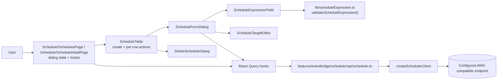
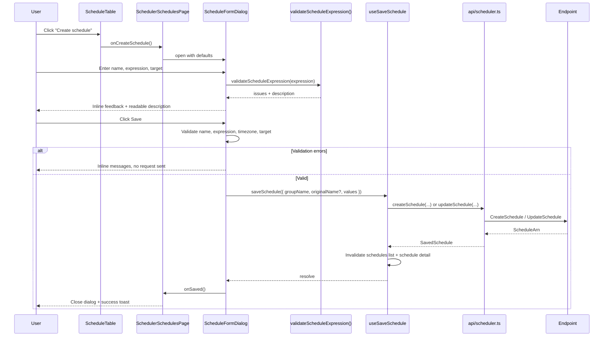
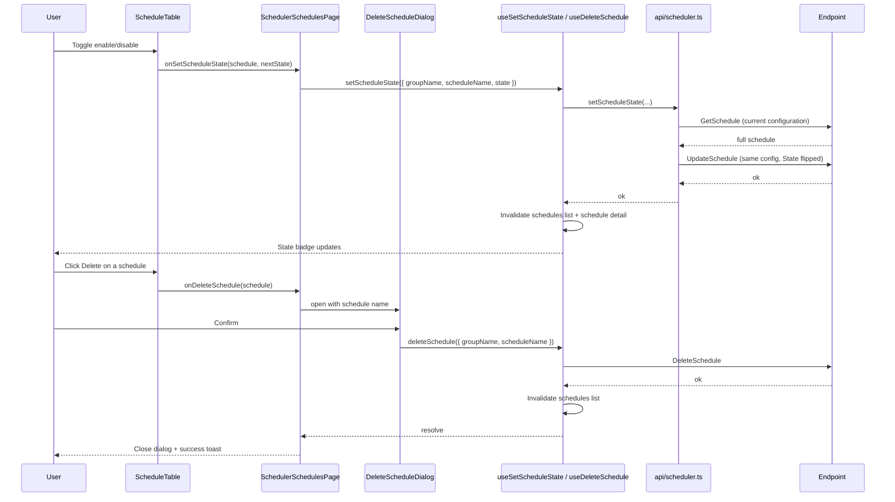

# Technical Specification: EventBridge Scheduler Schedule Management

## Architecture Overview

The feature extends the nested `scheduler/` module of the existing `eventbridge` feature (see [feature 010](../010-eventbridge-scheduler-management/spec.md)) rather than introducing a new module or a new SDK client. It follows the same layering established by EventBridge EventBus rule management (see [feature 012](../012-eventbridge-rule-management/spec.md)): the page owns dialog state, feature components own presentation and form validation, React Query hooks own the request lifecycle, and the Scheduler API module calls the AWS SDK through the shared `createSchedulerClient` factory.

Schedule management is performed from the schedules list of a group (`/eventbridge/scheduler/groups/:groupName/schedules`). The existing read-only `ScheduleTable` gains a create action and per-row view, edit, enable/disable, and delete actions. Create and edit share a single `ScheduleFormDialog` that hosts the schedule expression field (with live validation and a human-readable description) and the target editor. The schedule detail page (`SchedulerScheduleDetailPage`) exposes the same edit, enable/disable, and delete actions for the schedule it is showing.

A validator is added to the existing feature-local expression module (`src/features/eventbridge/scheduler/lib/scheduleExpression.ts`), which already provides `describeScheduleExpression`. The new `validateScheduleExpression` and `validateScheduleTimezone` are pure functions so they can be unit tested exhaustively and reused by the form.

Schedule **groups** remain read-only. No new routes are added.



### Create / update schedule flow



### Enable/disable and delete flow

`UpdateSchedule` replaces the entire schedule, so a state change must be sent as a full replacement built from the schedule's current configuration. `setScheduleState` therefore reads the schedule first and writes it back with only `State` changed.



## Project Structure

```text
src/
├── features/eventbridge/
│   ├── scheduler/
│   │   ├── api/
│   │   │   └── scheduler.ts              # Add createSchedule, updateSchedule, deleteSchedule, setScheduleState
│   │   ├── lib/
│   │   │   └── scheduleExpression.ts     # Add validateScheduleExpression, validateScheduleTimezone
│   │   ├── components/
│   │   │   ├── ScheduleTable.tsx         # Add create action + per-row actions
│   │   │   ├── ScheduleFormDialog.tsx    # NEW: create/edit form
│   │   │   ├── DeleteScheduleDialog.tsx  # NEW: destructive confirmation
│   │   │   ├── ScheduleExpressionField.tsx  # NEW: expression input + validation feedback
│   │   │   ├── ScheduleTargetEditor.tsx  # NEW: target configuration editor
│   │   │   └── index.ts                  # Export new components
│   │   ├── hooks/
│   │   │   ├── useSaveSchedule.ts        # NEW: create/update mutation
│   │   │   ├── useDeleteSchedule.ts      # NEW: delete mutation
│   │   │   ├── useSetScheduleState.ts    # NEW: enable/disable mutation
│   │   │   └── index.ts                  # Export new hooks
│   │   └── types/
│   │       └── scheduler.ts              # Add form/mutation + validation types
├── pages/
│   ├── SchedulerSchedulesPage.tsx        # Own schedule dialog state + toasts
│   └── SchedulerScheduleDetailPage.tsx   # Add edit/delete/state actions
tests/features/eventbridge/scheduler/
├── lib/schedule-expression.test.ts       # NEW/extended: validator unit tests
├── api/scheduler.test.ts                 # Extend with schedule mutation tests
├── hooks/scheduler-hooks.test.tsx        # Extend with mutation tests
└── components/scheduler-components.test.tsx  # Extend with dialog/editor tests
```

Add component boundaries only if the feature needs them; do not introduce abstractions the feature does not use.

## Data Structures

Add to `src/features/eventbridge/scheduler/types/scheduler.ts`. Reuse the existing `ScheduleState`, `ScheduleTarget`, `ScheduleRetryPolicy`, `ScheduleDeadLetterConfig`, and `FlexibleTimeWindow` types.

```typescript
type ActionAfterCompletion = 'NONE' | 'DELETE';

/** Editable target shape, aligned with the existing read-only ScheduleTarget. */
interface ScheduleTargetInput {
  arn: string;
  /** Required by the Scheduler API; nullable here because reads may omit it. */
  roleArn?: string;
  input?: string;
  retryPolicy?: ScheduleRetryPolicy;
  deadLetterConfig?: ScheduleDeadLetterConfig;
  sqsParameters?: { messageGroupId?: string };
  eventBridgeParameters?: { detailType?: string; source?: string };
  kinesisParameters?: { partitionKey?: string };
}

interface ScheduleFormValues {
  name: string;
  description?: string;
  scheduleExpression: string;
  scheduleExpressionTimezone: string;
  state: ScheduleState;
  actionAfterCompletion: ActionAfterCompletion;
  startDate?: string; // ISO 8601 string as entered
  endDate?: string; // ISO 8601 string as entered
  flexibleTimeWindow: FlexibleTimeWindow;
  target: ScheduleTargetInput;
}

interface SaveScheduleInput {
  groupName: string;
  /** Present when editing an existing schedule; the name is immutable. */
  originalName?: string;
  values: ScheduleFormValues;
}

interface DeleteScheduleInput {
  groupName: string;
  scheduleName: string;
}

interface SetScheduleStateInput {
  groupName: string;
  scheduleName: string;
  state: ScheduleState;
}

interface SavedSchedule {
  name: string;
  arn?: string;
}
```

### Validation types (shared by the expression and timezone validators)

```typescript
type ScheduleValidationSeverity = 'error' | 'warning';

interface ScheduleValidationIssue {
  /** Location within the validated value, e.g. "fields[3]" or "unit". */
  path: string;
  message: string;
  severity: ScheduleValidationSeverity;
}

type ScheduleExpressionKind = 'at' | 'rate' | 'cron';

interface ScheduleExpressionValidationResult {
  valid: boolean; // true when no error-severity issue exists
  kind?: ScheduleExpressionKind;
  description?: string; // reuses describeScheduleExpression when recognized
  issues: ScheduleValidationIssue[];
}

const SCHEDULE_EXPRESSION_MAX_LENGTH = 256;
```

## Schedule Expression Validator Specification

`validateScheduleExpression(value: string): ScheduleExpressionValidationResult` and `validateScheduleTimezone(value: string): ScheduleValidationIssue[]` are pure and dependency-free. They live in `src/features/eventbridge/scheduler/lib/scheduleExpression.ts` alongside the existing `describeScheduleExpression`.

### Step 1 — Shape

- Trim the input. An empty value produces a single error: `Schedule expression is required`.
- Enforce `SCHEDULE_EXPRESSION_MAX_LENGTH` (256) on the raw string; exceeding it produces an error and skips further checks.
- The value must match `at(...)`, `rate(...)`, or `cron(...)` (case-insensitive function name, closing parenthesis required). Any other form produces an error: `Schedule expression must be at(...), rate(...), or cron(...)`.

### Step 2 — `rate` validation

- Body must be `<value> <unit>` where `value` is a positive integer.
- `unit` must be one of `minute`, `minute(s)`, `hour`, `hour(s)`, `day`, `day(s)`.
- Errors: non-numeric or non-positive value (`path: "value"`), unsupported unit (`path: "unit"`).

### Step 3 — `cron` validation

- Body must contain exactly six space-separated fields in the order minutes, hours, day-of-month, month, day-of-week, year. A wrong field count is an error.
- Field value checks (each error uses `path: "fields[<index>]"`):
  - minutes: `*`, ranges/lists, `0`–`59`.
  - hours: `*`, ranges/lists, `0`–`23`.
  - day-of-month: `*`, `?`, `L`, `W`, `#n`, ranges/lists within `1`–`31`.
  - month: `*`, `1`–`12`, or `JAN`–`DEC`.
  - day-of-week: `*`, `?`, `L`, `#n`, `1`–`7`, or `SUN`–`SAT`.
  - year: `*` or a four-digit year between `1970` and `2199`.
- At most one of day-of-month and day-of-week may be `*`; the other must be `?`. Both being `*` is an error (the schedule would be ambiguous).
- Ranges, lists, and step values (`a-b`, `a,b`, `*/n`, `a-b/n`) are structurally validated; individual combinatorics are not exhaustively enumerated.

### Step 4 — `at` validation

- Body must parse as a timestamp of the form `YYYY-MM-DDThh:mm:ss` (seconds optional). An unparseable value is an error.
- A timestamp in the past produces a **warning** (`This one-time schedule is in the past`) rather than an error, so clock skew does not block saving.
- Seconds are not accepted with a timezone suffix; the schedule's own timezone applies.

### Step 5 — Result assembly

- `kind` is set when the form is recognized.
- `description` reuses `describeScheduleExpression` so the field can show the same human-readable hint as the detail view.
- `valid` is `true` only when no `error`-severity issue exists.
- Issues are ordered deterministically (shape first, then field order) for stable display and testing.

### Timezone validation

`validateScheduleTimezone(value: string): ScheduleValidationIssue[]`

- Required and non-empty; an empty value is an error.
- When `Intl.supportedValuesOf('timeZone')` is available, the value must be a member of that list; otherwise the value is only checked for non-empty IANA-like form (`Area/Location`). This keeps validation strict in modern browsers and permissive in test environments.
- A malformed value is an error: `"<value>" is not a recognized IANA time zone`.

## API and Service Layer

Extend `src/features/eventbridge/scheduler/api/scheduler.ts`. Reuse `createSchedulerClient` from `src/services/aws.ts`, pass the active endpoint and region to every operation, and destroy the client in a `finally` block, matching `listSchedules` and `getScheduleDetails`.

`CreateSchedule`, `UpdateSchedule`, and `DeleteSchedule` are already available from `@aws-sdk/client-scheduler`; only read commands are currently imported, so the import list must be extended.

| Operation          | AWS SDK command                                    | Input                                | Output          | Behavior                                                                                                              |
| ------------------ | -------------------------------------------------- | ------------------------------------ | --------------- | --------------------------------------------------------------------------------------------------------------------- |
| `createSchedule`   | `CreateScheduleCommand`                            | `groupName`, `values`                | `SavedSchedule` | Create a schedule with the full form configuration; `State` may be `DISABLED`                                         |
| `updateSchedule`   | `UpdateScheduleCommand`                            | `groupName`, `values`                | `SavedSchedule` | Replace an existing schedule; `UpdateSchedule` is a full replacement, so every field is sent                          |
| `deleteSchedule`   | `DeleteScheduleCommand`                            | `groupName`, `scheduleName`          | `void`          | Permanently remove the schedule                                                                                       |
| `setScheduleState` | `GetScheduleCommand`, then `UpdateScheduleCommand` | `groupName`, `scheduleName`, `state` | `void`          | Read the current schedule, rebuild the full input preserving every field, and write it back with only `State` changed |

### Save orchestration

`saveSchedule(input: SaveScheduleInput, config?)`:

1. Build the SDK input from the form values, mapping `ScheduleTargetInput` to the SDK `Target` shape (`RetryPolicy`, `DeadLetterConfig`, `SqsParameters`, `EventBridgeParameters`, `KinesisParameters`).
2. Omit `StartDate`/`EndDate`/`Description` when blank.
3. Always send `FlexibleTimeWindow` (the API requires it; the form defaults to `{ mode: 'OFF' }`) and `ScheduleExpressionTimezone` (defaults to `UTC`).
4. Call `UpdateSchedule` when `originalName` is present, otherwise `CreateSchedule`.
5. Map the SDK `ScheduleArn` response to `SavedSchedule`.

Behavior notes:

- `UpdateSchedule` **replaces** the schedule. There is no partial update; do not send a reduced payload when toggling state or editing a single field.
- Do not set `ClientToken`; the UI performs no automatic retry, so idempotency tokens are unnecessary and would complicate the API surface.
- Map SDK PascalCase responses to camelCase domain types at the API boundary; reuse `mapTarget` for the prefill path.
- Do not convert thrown errors into empty arrays or success-shaped results.

## State Management

### Existing queries (reused)

- Schedules list: `['scheduler', 'schedules', endpoint, region, groupName, state ?? 'all', nextToken]` via `useSchedules`.
- Schedule details: `['scheduler', 'schedule', endpoint, region, groupName, scheduleName]` via `useScheduleDetails`.

### New mutations

| Hook                  | Mutation                       | Invalidation on success                                                                      |
| --------------------- | ------------------------------ | -------------------------------------------------------------------------------------------- |
| `useSaveSchedule`     | `saveSchedule` (create/update) | Invalidate the group's `schedules` query and the `schedule` detail key for the affected name |
| `useDeleteSchedule`   | `deleteSchedule`               | Invalidate the group's `schedules` query and the deleted `schedule` detail key               |
| `useSetScheduleState` | `setScheduleState`             | Invalidate the group's `schedules` query and the `schedule` detail key                       |

Each hook:

- Includes the active endpoint and region in its keys and request config, taken from `useSettings`.
- Exposes `pending` and `error` so dialogs can disable their confirm buttons and show real errors.
- Uses `retry: false` for create/update/delete, consistent with the destructive-operation guidance in features 009 and 012.

Dialog and pending state live in `SchedulerSchedulesPage`; form values live in `ScheduleFormDialog`. `SchedulerScheduleDetailPage` reuses the same hooks for its own actions.

## UI/UX Details

### Page title

- Category label (uppercase, small): `EventBridge Scheduler`.
- Main title (large): `Schedules`; the group name stays visible below the title.
- Right side: state filter, refresh action, and the primary `Create schedule` action.

### Schedules list (extended)

- Keeps the existing columns: name, state `Badge`, target ARN, last modification date.
- Actions column gains, alongside `View` (`Info`):
  - an enable/disable control labelled `Enable`/`Disable` for the schedule,
  - `Edit` (`Pencil` icon, `variant="ghost"`, `size="icon"`),
  - `Delete` (`Trash2` icon, red styling per `docs/ui-patterns.md`).
- Actions are disabled while their request is pending; the create action is disabled while the list is refetching.
- Empty state gains the `Create schedule` call to action.
- Pagination and the state filter are unchanged.

### Schedule detail (extended)

- The existing metadata and target sections stay as they are.
- The header gains the same `Edit`, enable/disable, and `Delete` actions as the list row, wired to the shared hooks.
- After a successful edit or state change the detail data is refetched so the view matches the service.

### ScheduleFormDialog (create and edit)

- Fields: name (required; disabled and explained when editing), description (optional), schedule expression + time zone, enabled toggle, start/end dates, flexible time window, action after completion, and the target editor.
- Defaults: time zone `UTC`, flexible time window `{ mode: 'OFF' }`, action after completion `NONE`, state `ENABLED`.
- Name validation: required, length ≤ 64, matching `[0-9A-Za-z-_.]+`.
- On edit, the form is pre-filled from `useScheduleDetails`; the dialog shows a loading state until the schedule is available and does not submit with stale values.
- Uses project-owned `Dialog`, `Input`, `Label`, `Textarea`, `Select`, `Toggle`, `Button`, and `Alert` primitives. No new third-party form, cron, or date library is introduced.
- Footer: `Cancel` (`DialogAction`) and `Save` (primary). `Save` is disabled while the form is invalid or a request is pending.
- On success the dialog closes, the queries are invalidated, and a success toast is shown. On failure the dialog stays open, values are preserved, and the error is shown in an `Alert`.

### ScheduleExpressionField

- `Input` (or `Textarea`) bound to the expression with `aria-describedby` pointing at the feedback region and `aria-invalid` set when errors exist.
- Validates through `validateScheduleExpression` as the developer types, plus immediate validation on blur.
- Feedback region lists every issue with its location and message and is announced through `role="status"` / `aria-live="polite"`.
- Shows the human-readable description (`describeScheduleExpression`) next to the valid expression, always alongside the raw expression.
- A separate time-zone field validates through `validateScheduleTimezone` and shows its own inline error.

### ScheduleTargetEditor

- Fields: target ARN (required, basic `arn:partition:service:region:account:resource` validation), role ARN (required by the Scheduler API, with the same shape check), input payload (optional; must be valid JSON when provided, otherwise an inline error), retry policy (maximum event age and maximum retry attempts, with range validation), and dead-letter queue ARN (optional).
- Target-type-specific parameters are offered based on the service segment of the target ARN: `SqsParameters` for `sqs`, `EventBridgeParameters` for `events`, and `KinesisParameters` for `kinesis`. Unknown services show only the generic fields.
- Retry policy bounds: maximum retry attempts `0`–`185`; maximum event age `60`–`86400` seconds.
- Clearing a field removes it from the payload rather than sending an empty string.

### DeleteScheduleDialog

- Reuses the `Dialog` pattern from `DeleteEventBusDialog` and `DeleteRuleDialog`.
- Names the schedule and warns that the action is permanent.
- The destructive confirm button shows a pending state and cannot be submitted twice.

Ensure keyboard navigation, accessible labels, visible focus states, and responsive layout (the target editor stacks on narrow viewports). Reuse project-owned primitives; do not add third-party cron or form libraries.

## Routing

No changes. Schedule management is rendered inside the existing routes.

| Path                                                               | View                                                      | Parameters                                 |
| ------------------------------------------------------------------ | --------------------------------------------------------- | ------------------------------------------ |
| `/eventbridge/scheduler/groups/:groupName/schedules`               | `SchedulerSchedulesPage` (list + schedule management)     | `groupName`, state filter, list pagination |
| `/eventbridge/scheduler/groups/:groupName/schedules/:scheduleName` | `SchedulerScheduleDetailPage` (detail + schedule actions) | `groupName`, `scheduleName`                |

## Error Handling

- Expression or time-zone validation error: inline field error, submission blocked, no request sent.
- Name invalid or duplicate (`ConflictException`): inline validation first; the service error is shown in the dialog with values preserved.
- Missing schedule on edit/delete/state change (`ResourceNotFoundException`): toast the real error and refetch so the UI converges.
- `ValidationException` from the service (for example an out-of-range field the client missed): surface the real message in the dialog.
- State change failure: keep the previous state and show the real error; the list is refetched.
- Request failures: the dialog stays open, the error is shown in an `Alert`, and no automatic retry occurs.
- Pagination, state filtering, and empty-vs-error states for the schedules list are unchanged from feature 010.

## Security and Configuration

- Use the active endpoint and region from the existing settings context; follow the established local-emulator dummy-credential configuration.
- Do not add permanent AWS credentials to source, build-time environment variables, or browser storage.
- Mutations run only on explicit user action; do not log target input payloads or credentials.
- The expression and time-zone validators run entirely in the browser and must not call any external service.

## Local MinStack Resource Provisioning

Schedule creation and target management are exercised through the existing Scheduler helpers, extended rather than duplicated:

- `scripts/create-scheduler-schedule-group.mjs` continues to create the custom schedule group only (idempotent, local endpoint and dummy credentials by default, `AWS_ENDPOINT`, `AWS_REGION`, `SCHEDULE_GROUP_NAME` overrides).
- `scripts/scheduler-test-data.mjs` is extended so the seeded sample covers the schedule-management surface: keep at least one ENABLED and one DISABLED schedule, add a schedule with a retry policy and a dead-letter queue, and add a schedule whose target uses a target-type-specific parameter (for example an SQS target with `SqsParameters.MessageGroupId`) so the target editor has realistic data to round-trip.
- The sample-data script keeps using `CreateSchedule`/`UpdateSchedule` upsert semantics: it updates an existing schedule instead of failing, and never deletes unrelated resources.
- Both scripts keep the existing guarantees: local endpoint default (`http://localhost:4566`), dummy credentials (`test`/`test`), every schedule setting a `ScheduleExpression`, a target with a role ARN, and `FlexibleTimeWindow` mode `OFF` (required by the API), and no use with real AWS credentials or endpoints.
- These helpers prepare local emulator data only and are distinct from unit tests and browser validation.

## Dependencies

- No new runtime dependencies. `@aws-sdk/client-scheduler` is already installed and provides `CreateScheduleCommand`, `UpdateScheduleCommand`, and `DeleteScheduleCommand`.
- Reuse existing React Query, settings, toast, dialog, select, toggle, and project UI dependencies.

## Related Documents

- [Feature 010 — EventBridge Scheduler Management](../010-eventbridge-scheduler-management/spec.md)
- [Feature 012 — EventBridge Rule Management](../012-eventbridge-rule-management/spec.md)
- [UI Patterns](../../docs/ui-patterns.md)
